# BookTrack

[](https://github.com/mukraminbariwa5-create/booktrack/actions/workflows/tests.yml)

A library management system for small libraries, built with plain PHP and MySQL. Members browse the catalogue, borrow and renew books, and message the librarian. Librarians run the whole library from one dashboard: circulation, books, members and messages.

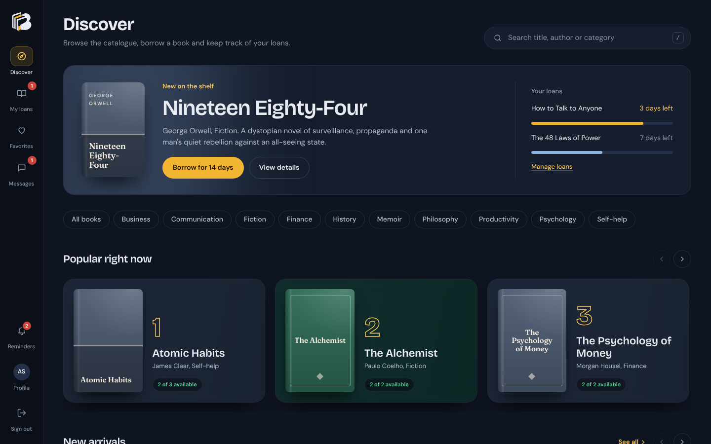

| Librarian overview | Circulation |
|---|---|
| 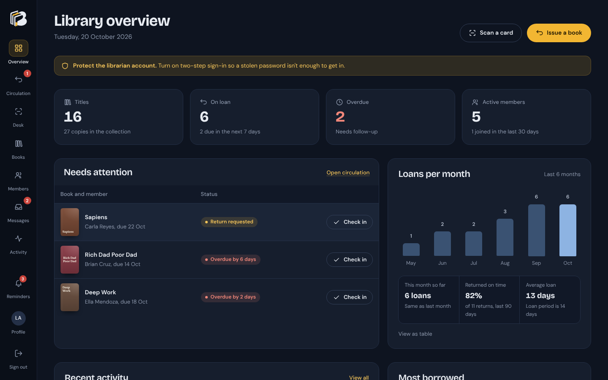 | 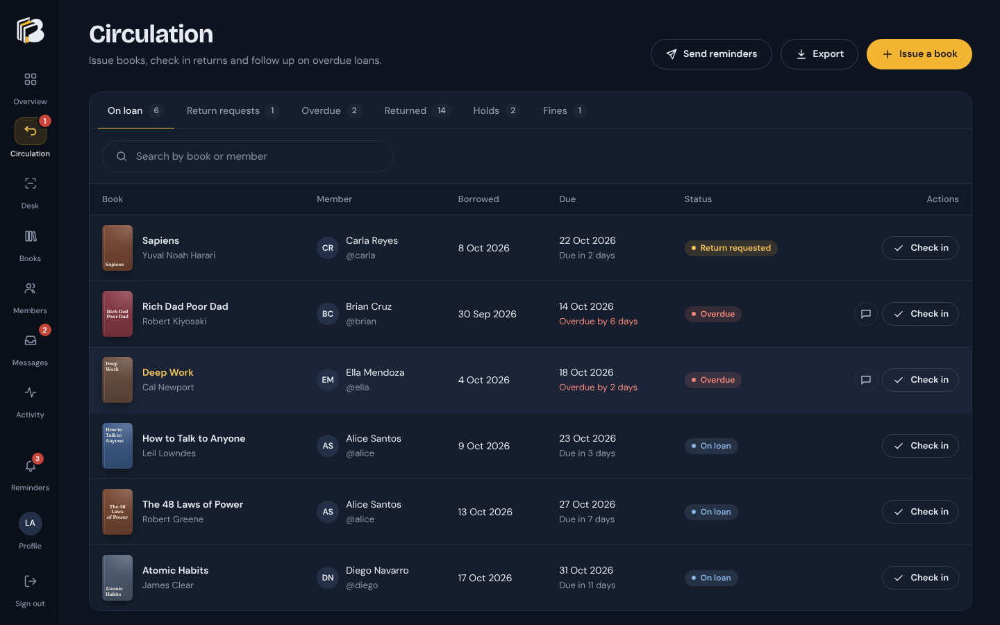 |
| **Book page** | **My loans** |
| 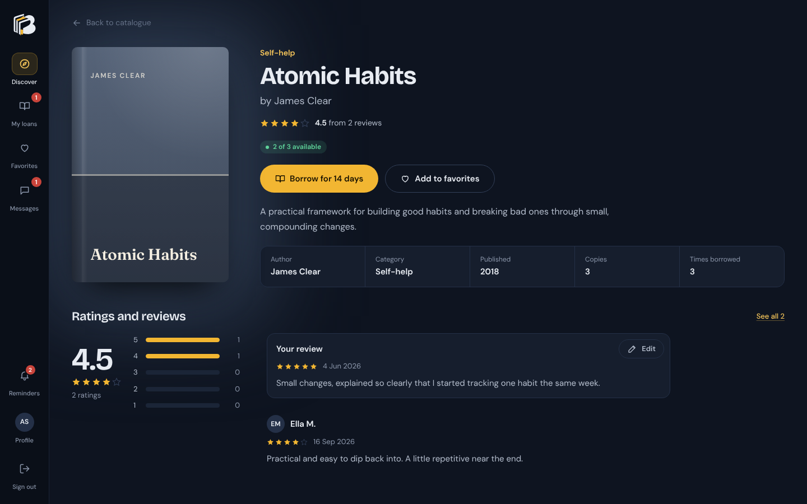 | 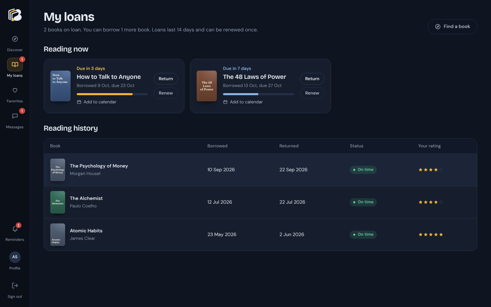 |
| **Library card** | **Desk** |
| 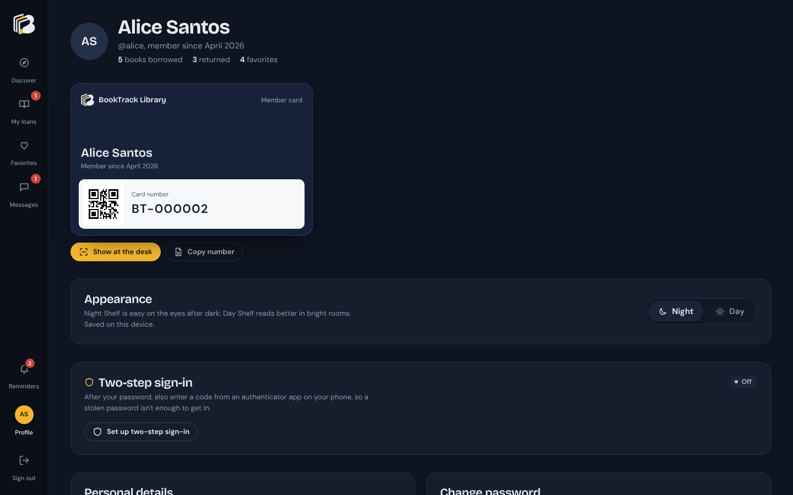 | 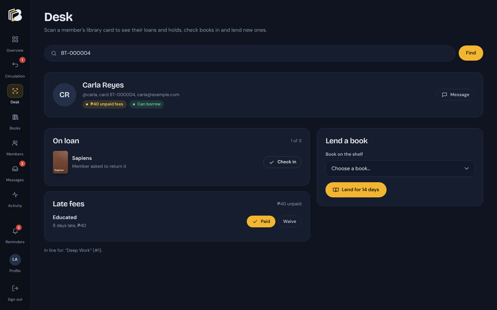 |
| **Sign in** | **Mobile** |
| 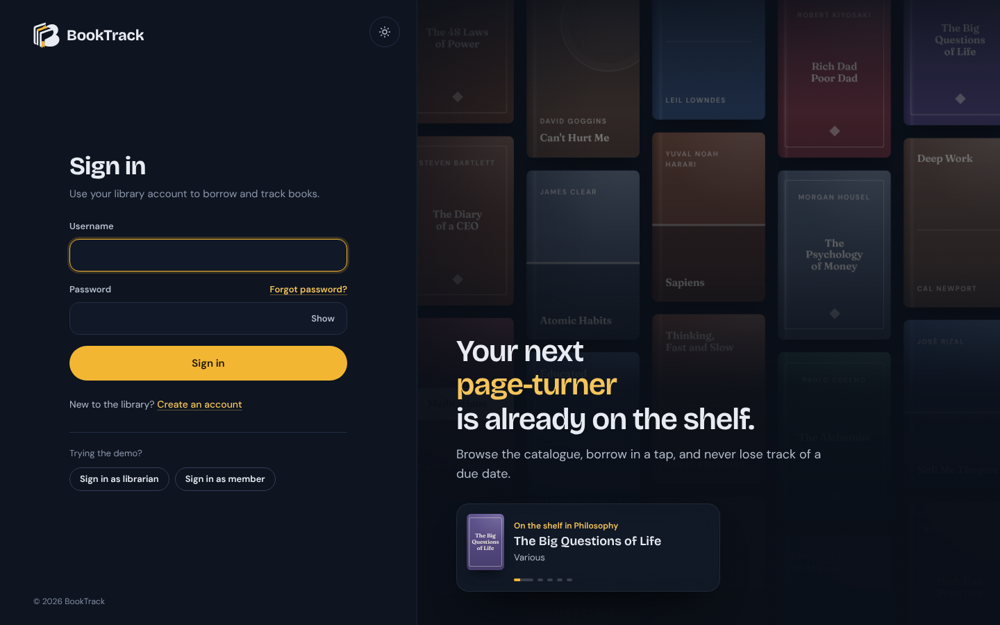 | 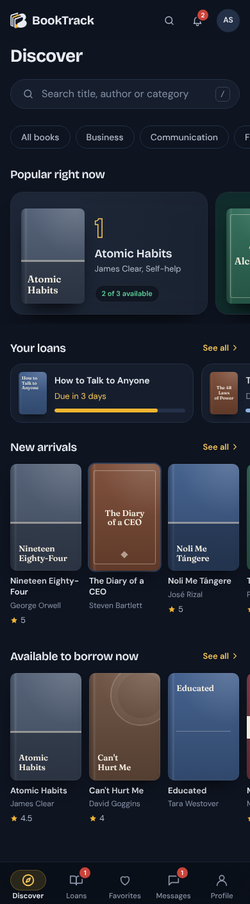 |
| **Late fees** | **Two-step sign-in** |
| 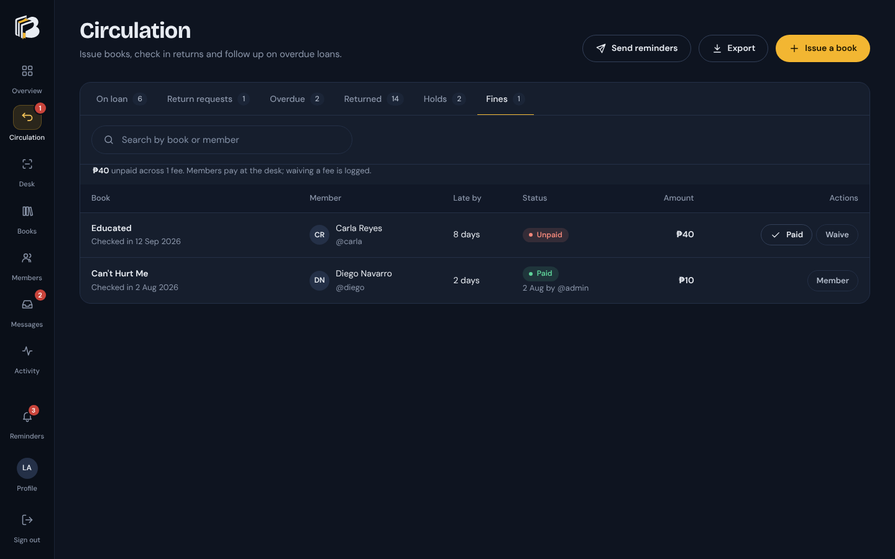 | 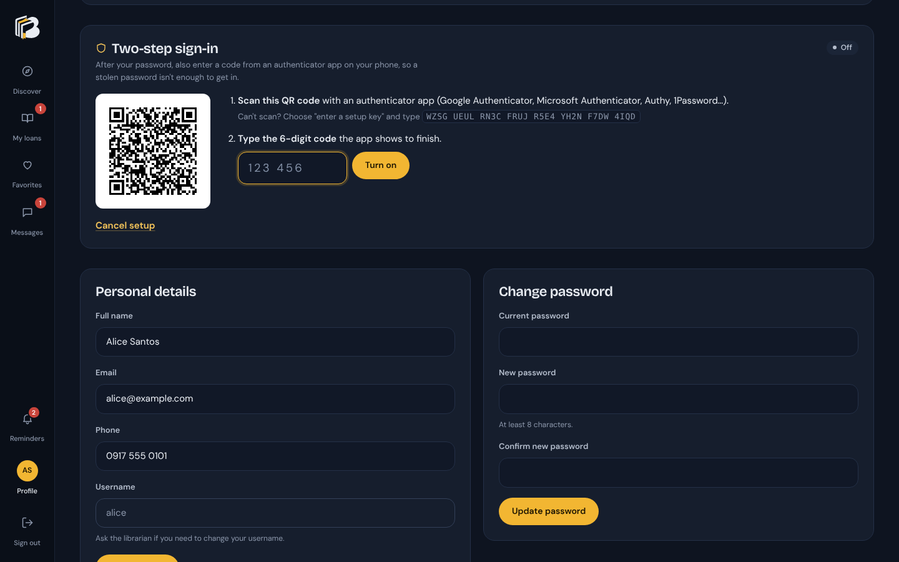 |

## Features

**For members**
- Create an account from the sign-in page and start borrowing right away
- Forgot your password? Get a one-time reset link by email (it expires after 30 minutes)
- Browse the catalogue with search, categories, sorting and an "available now" filter
- Book pages with description, live availability and when the next copy is due back
- Borrow in one click, renew once for 7 more days, and request a return
- Place a hold when every copy is out: see your place in line, and when a copy comes back it's kept for you for 3 days (with an email)
- Reminder emails two days before a book is due and when it becomes overdue
- Late fees shown as they grow ("Late fee so far: ₱30"), with a Late fees section listing what's unpaid, paid or waived
- Two-step sign-in with any authenticator app (Google Authenticator, Microsoft Authenticator, Authy…), set up from a QR code, with 10 one-time recovery codes
- Add a due date to Google Calendar, Outlook or Apple Calendar in one click (with a reminder the day before)
- Rate and review books you've borrowed, from a quick star row or a bottom sheet on phones. Each book shows its average with a 5-to-1 star breakdown and the newest reviews; "See all" filters by stars, sorts, and pages through hundreds of reviews. Ratings also appear on every book card, with a "Top rated" sort
- A digital library card on the profile page, with a full-screen QR view to show at the desk
- Due-date countdowns that turn gold when a book is due soon and red when it's overdue
- Favorites, reading history, and a Messenger-style chat with the library (live updates, "Seen", Enter to send)
- Read attached e-book PDFs (signed-in users only)
- Instant search from any page (Ctrl+K or `/`): books appear as you type, with arrow-key navigation and page shortcuts
- A reminders bell for books due soon or overdue and new replies from the library
- Undo instead of "are you sure?" for reversible actions (favorites, return requests)
- Night (dark) and Day (light) themes, remembered per device

**For librarians**
- Overview dashboard: key numbers, return requests and overdue loans to action, loans per month, most borrowed books and recent activity
- Circulation: issue books at the desk, check in returns, and filter by on loan, return requests, overdue, returned or holds
- Desk: scan a member's library card (QR with the phone camera, a USB scanner, or type the number or a name) to see their holds, loans and status, then check books in or lend new ones in one place
- Holds queue per book; a returned copy goes straight to the next member in line, and uncollected holds expire on their own
- "Send reminders" button for due-soon and overdue emails (they also go out automatically once a day), plus a one-click message to any member with an overdue book
- Books: add, edit and delete books, with cover and PDF uploads and multiple copies
- Real covers from [Open Library](https://openlibrary.org): looked up by ISBN or title when a book is added, with "Find online" in the book form and "Find missing covers" for the whole catalogue; books with no cover anywhere get one of five designed jackets
- Remove inappropriate reviews from any book page
- Instant search also finds members, and the reminders bell lists returns to check in, overdue books and members waiting for a reply
- Members: add, edit, deactivate or delete accounts and reset passwords
- Late fees: charged automatically when a late book is checked in, collected at the Desk or from the Fines tab in Circulation (mark paid or waive, both logged)
- Turn off a member's two-step sign-in at the Desk when they've lost their phone, after checking who they are in person
- Export to CSV (opens in Excel): any Circulation tab, the member list or the catalogue, using the filters on screen
- Two-pane chat inbox: every conversation shows the member's name, @username, unread count and loans at a glance; quick replies; start a chat with any member
- An activity log of every change

**Library rules** (in `config.php`)
- Loan period (14 days), maximum books per member (3), and the "due soon" window (3 days)
- Members with an overdue book can't borrow until it's returned
- Holds: up to 3 per member, and a returned copy is kept for 3 days (`max_holds`, `hold_pickup_days`)
- Reminder emails: due-soon notice 2 days ahead (`mail.remind_days_before`)
- Late fees: ₱5 a day, at most ₱200 per book, and borrowing pauses once unpaid fees reach ₱100 (`fines`). Set `'enabled' => false` to turn them off
- Librarians can be required to use two-step sign-in (`auth.require_2fa_for_librarians`)
- Availability is calculated from the loans themselves, so it can never drift out of sync

## Tech stack

- PHP 8.1+ (no framework, no Composer dependencies) with PDO and prepared statements
- MySQL / MariaDB (XAMPP)
- Hand-written CSS design system ("Night Shelf": deep navy surfaces, an icon rail, one gold accent from the logo, Bricolage Grotesque + DM Sans), responsive down to phone size, with Night and Day themes
- Fonts served from the project itself (`assets/fonts`), so pages make no third-party requests and look right offline
- Accessibility: keyboard navigation with a skip link and visible focus, labelled controls, and text contrast of at least 4.5:1 in both themes
- A little vanilla JavaScript for progressive enhancement. Every page also works without it.

## Security

The full threat model, with every defense and its known limits, is in **[SECURITY.md](SECURITY.md)**.

- Optional two-step sign-in (TOTP, RFC 6238) with replay protection, rate-limited codes and hashed one-time recovery codes; it can be made mandatory for librarians
- Passwords hashed with `password_hash`, and the session ID is regenerated on login and on password change
- Password reset links carry a random 256-bit token. Only its SHA-256 hash is stored, links work once and expire after 30 minutes, the page gives the same answer whether or not an account exists (no username probing), and requests are rate-limited per account and per connection
- Brute-force protection stored in the database: 5 failed sign-ins lock that username for 5 minutes (20 lock the IP address), so clearing cookies doesn't get around it
- Every form is validated on the server too (required fields, formats and lengths that match the database columns)
- CSRF tokens on every form and POST request
- Role checks on every page and endpoint (member vs. librarian)
- All output escaped, and all SQL uses bound parameters
- Uploads are checked by their real content (image headers, the `%PDF-` signature), large covers are resized, and nothing in `uploads/` can run as code
- PDFs are served through `read.php` to signed-in users only
- Cover lookups only ever download from the Open Library covers host, and are checked like uploads
- `.htaccess` rules block direct access to `includes/`, `database/`, `tests/` and the config
- A Content-Security-Policy on every page: scripts load only from BookTrack's own files (no inline or injected scripts), pages can't be framed by other sites, and forms can only post back to BookTrack
- CSV exports neutralise cells that start like a spreadsheet formula (`=`, `+`, `-`, `@`), so a book title can't run as a formula on a librarian's computer

## Getting started (XAMPP on Windows)

1. Copy the project folder into `C:\xampp\htdocs\` (for example, `C:\xampp\htdocs\booktrack-v2`).
2. Start **Apache** and **MySQL** in the XAMPP Control Panel.
3. Open **http://localhost/booktrack-v2/setup.php** and click **Create database**.
   Or import `database/booktrack.sql` in phpMyAdmin.
4. Sign in at **http://localhost/booktrack-v2/**

| Role | Username | Password |
|---|---|---|
| Librarian | `admin` | `admin123` |
| Member | `alice` (also `brian`, `carla`, `diego`, `ella`) | `member123` |

If your MySQL user has a password, or you want a different database name, edit `config.php`.

### Reminder emails

Out of the box (`'driver' => 'log'` in `config.php`), BookTrack saves every email it would send as an `.eml` file in `storage/mail/`. Double-click one to open it in Outlook or Windows Mail. This works on a fresh XAMPP install with no mail server.

Reminders go out on the first page view of each day, and librarians can send them any time from **Circulation → Send reminders**. No member gets the same reminder twice. To send them at a fixed time even when nobody visits, add a daily task in Windows Task Scheduler that runs:

```
C:\xampp\php\php.exe C:\xampp\htdocs\booktrack-v2\cron\send_reminders.php
```

To send real email, use the `'smtp'` driver with any SMTP account (Gmail with an app password, Brevo, your host's mailbox). The settings go in `config.local.php`; `config.local.example.php` shows them. PHP's own `mail()` (`'driver' => 'mail'`) also works where the server has it set up.

### Settings for one server: `config.local.php`

`config.php` holds the defaults and is in git. Settings for one server, such as the database password and SMTP login, go in **`config.local.php`** (copy `config.local.example.php`). It overrides anything in `config.php`, it's in `.gitignore`, and `.htaccess` blocks it from the web.

### Putting it online

**[DEPLOY.md](DEPLOY.md)** walks through putting BookTrack on free hosting as a public demo: upload, `config.local.php`, `setup.php`, email and HTTPS. Demo mode (`'demo' => ['enabled' => true]`) shows the one-click demo sign-ins, protects the demo accounts from being changed or deleted, turns off uploads, and puts the demo data back every day.

For a real library instead, follow the checklist in [SECURITY.md](SECURITY.md#before-going-live): HTTPS, `'debug' => false`, its own database user, new passwords for the demo accounts, and two-step sign-in for every librarian. `setup.php` refuses to run once the library is installed, so it can't wipe your data.

## Project structure

```
├── index.php, login.php, logout.php, setup.php
├── forgot_password.php, reset_password.php   ← password reset by email
├── two_factor.php            ← the code step of two-step sign-in
├── config.php                ← default settings (config.local.php overrides them per server)
├── discover.php, book.php, loans.php, favorites.php, messages.php, profile.php   ← member pages
├── read.php                  ← streams PDFs to signed-in users
├── calendar.php              ← a loan's due date as a calendar event (.ics)
├── reviews.php               ← all ratings and reviews for a book (filters, sort, pages)
├── cron/send_reminders.php   ← optional scheduled task for reminder emails
├── admin/                    ← librarian pages (overview, desk, loans, books, members, messages, activity)
├── admin/export.php          ← CSV downloads of loans, members and books
├── api/favorite.php          ← JSON endpoint for favorite toggling
├── api/chat.php              ← JSON endpoint for sending and receiving chat messages
├── includes/
│   ├── bootstrap.php         ← config, session, security headers
│   ├── db.php                ← PDO connection and query helpers
│   ├── auth.php              ← sign-in, roles, rate limiting
│   ├── password_reset.php    ← reset links (hashed tokens, expiry, rate limits)
│   ├── two_factor.php        ← TOTP codes, recovery codes, the pending sign-in step
│   ├── fines.php             ← late fees (charge at check-in, pay, waive)
│   ├── demo.php              ← public demo mode and the daily reset
│   ├── installer.php         ← loads database/booktrack.sql (setup.php and the demo reset)
│   ├── library.php           ← circulation rules (borrow, renew, return, availability)
│   ├── holds.php             ← the hold queue (place, keep a copy, expire, cancel)
│   ├── reminders.php         ← due-soon, overdue and hold-ready emails
│   ├── mailer.php            ← sends email, or saves it to storage/mail
│   ├── reviews.php           ← ratings and reviews
│   ├── qr.php                ← QR code generator for library cards (no dependencies)
│   ├── helpers.php           ← escaping, CSRF, flash messages, uploads, formatting
│   └── partials/             ← page shell, book card, loan card
├── assets/css/app.css        ← design system
├── assets/fonts/             ← self-hosted fonts (SIL Open Font License)
├── assets/js/app.js          ← dialogs, confirmations, favorites, mobile menu
├── database/booktrack.sql    ← schema and demo data
├── uploads/                  ← covers (public) and pdfs (private)
├── storage/                  ← saved emails and the daily reminder stamp (not public)
├── tools/                    ← command-line tools: reset a locked-out account's two-step sign-in, reset the demo
├── tests/                    ← rule tests (run on SQLite) and the end-to-end suite
└── .github/workflows/        ← runs every test on each push, on SQLite, MySQL and MariaDB
```

## Tests

Every push runs all of the tests below on GitHub Actions (the badge at the top): on PHP 8.1 and 8.3, and end to end on SQLite, MySQL 8 (installed through `setup.php` into a hosting-style database) and MariaDB 10.11 (the SQL file imported as XAMPP would).

The library rules (availability, loan limits, overdue blocking, renewals, returns, holds, reminder emails, late fees, ratings and reviews, favorites, sign-in lockout, two-step sign-in including the RFC 6238 test vectors, password reset links, public demo protection and seeded logins) are covered by a test script that runs against a throwaway SQLite database. It needs the `pdo_sqlite` extension:

```
php tests/rules_test.php
php tests/chat_migration_test.php   # upgrading an older install carries old messages into chats
```

An end-to-end script signs in as a member, a librarian and a guest and drives every action over HTTP: borrowing limits, renewals, returns and check-in, favorites, messages, book and member management, upload checks, private PDFs, CSRF rejection, the lockout, CSV exports, late fees, two-step sign-in, the password reset pages and the security headers. Run it against a freshly installed copy (it needs Python with `requests`):

```
BOOKTRACK_URL=http://localhost/booktrack-v2 python tests/e2e_test.py
```

## Demo covers

The demo catalogue uses real book titles with short original summaries. Cover artwork isn't included in this repository, so every demo book shows BookTrack's generated typographic cover (seen in the screenshots). Librarians can upload real covers from **Books → Edit**.

## Author & license

Built by **Mukramin Bariwa Ansao**. Released under the [MIT License](LICENSE).
